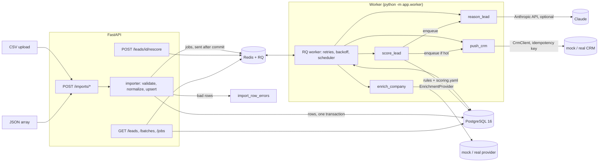

# Project 1: Lead Generation and Qualification

A Python backend plus a background worker. Leads are imported from CSV or an API, enriched with
company data, scored by transparent rules, given an LLM-written explanation, segmented, and pushed
to a CRM when they qualify.

## Problem statement

Sales teams receive lead lists of uneven quality and waste time on people who will never buy.
This service answers three questions for every lead, and keeps the evidence:

1. **How good is this lead?** A 0-100 score from explicit, versioned rules, with a per-rule
   breakdown anyone can audit. No model decides the number.
2. **Why?** A short LLM explanation of the breakdown, which is optional and can fail without
   affecting the score.
3. **What next?** A segment (`hot` / `nurture` / `disqualified`); hot leads go to the CRM exactly
   once per score.

Status: base build, React frontend, the Redis + RQ upgrade and the HubSpot CRM adapter are complete.
The remaining upgrades are pending an owner decision (see the end of this file).

## Architecture



The queue in Redis is the only coupling between the API and the worker; both share Postgres for data.

Data flow for one lead: import (upsert lead + company, enqueue `enrich_company` and `score_lead`)
-> enrich -> score (new `lead_scores` row, set `segment`) -> `reason_lead` (if enabled) and
`push_crm` (if hot).

## Setup

```bash
cp .env.example .env
make up                       # Postgres 16, Redis 7, API on :8000 (runs migrations), worker
curl localhost:8000/health
open http://localhost:8000/docs
```

Without Docker for the app itself (Python 3.12):

```bash
python -m venv .venv && . .venv/bin/activate
pip install -e ".[dev]"
make db && make migrate       # Postgres via docker compose, then alembic upgrade head
docker compose up -d redis    # the queue
make api                      # terminal 1
make worker                   # terminal 2
```

| Command          | What it does                                                          |
|------------------|-----------------------------------------------------------------------|
| `make test`      | starts Postgres, runs unit + integration tests with coverage (Redis is faked in-process, no server needed) |
| `make lint`      | ruff                                                                  |
| `make typecheck` | mypy, strict on `app/`                                                |
| `make frontend`  | install and run the React dev server on :5173                         |

`make test` creates the `leadgen_test` database if it is missing and migrates it with Alembic.
Set `SKIP_DB=1` to reuse a Postgres you already have at `TEST_DATABASE_URL`. Coverage on
`app/services` is above 97%.

## Frontend

A small React + TypeScript app (Vite) in `frontend/`: import CSV or JSON and see rejected rows,
browse leads by segment with pagination, open a lead for its score, per-rule breakdown, explanation
and score history (with a Rescore button), and inspect jobs (failed by default).

```bash
make up                # API on :8000 and the worker
make frontend          # npm install + vite dev server on http://localhost:5173
```

The dev server proxies `/api/*` to the API (`VITE_API_TARGET`, default `http://localhost:8000`), so
the backend needs no CORS configuration. `npm run build` type-checks and produces `frontend/dist`.
The frontend is not part of docker-compose: it is a dev-time UI, not a deployed service.

## Example requests

```bash
# Import the sample CSV: 10 rows, 7 accepted, 3 rejected with reasons
curl -F "file=@examples/leads.csv" localhost:8000/imports/csv

# Import JSON (same code path)
curl -X POST localhost:8000/imports/api -H 'content-type: application/json' \
  -d '[{"email":"Jane@Acme.com","company_domain":"www.acme.com","job_title":"VP Sales"}]'

curl localhost:8000/batches/1                         # summary + row errors
curl 'localhost:8000/leads?segment=hot&limit=20&offset=0'
curl localhost:8000/leads/1                           # latest score, breakdown, reasoning
curl localhost:8000/leads/1/scores                    # full score history, newest first
curl -X POST localhost:8000/leads/1/rescore           # queue a fresh scoring run (202)
curl 'localhost:8000/jobs?status=failed'              # inspect dead jobs and last_error
```

## Configuration

All configuration is environment variables (see `.env.example`). Integration placeholders
(`ENRICHMENT_PROVIDER`, `ENRICHMENT_API_KEY`, `CRM_PROVIDER`, `CRM_API_TOKEN`, `ANTHROPIC_API_KEY`,
`ANTHROPIC_MODEL`, `REASONING_ENABLED`) ship empty: an empty provider or model falls back to the
built-in default (`mock`, `claude-haiku-5-5`) and an empty `REASONING_ENABLED` means `false`.
No secret is hardcoded and `.env` is git-ignored.

Queue knobs: `REDIS_URL`, `QUEUE_NAME`, `JOB_MAX_ATTEMPTS`, `JOB_BACKOFF_BASE_SECONDS`,
`JOB_TIMEOUT_SECONDS`, `JOB_RESULT_TTL_SECONDS`, `JOB_FAILURE_TTL_SECONDS`, `SCORE_DEFER_SECONDS`. Also
`REASONING_MAX_TOKENS`, `SCORING_CONFIG_PATH`.

## How it works

### Import
`POST /imports/csv` (multipart) requires `email` and `company_domain`; `first_name`, `last_name`,
`job_title` are optional. Emails and domains are lower-cased and a leading `www.` is stripped from
domains. Invalid rows are stored in `import_row_errors` with a reason and the raw payload, never
dropped. Valid rows upsert the lead (by email) and company (by domain), then jobs are enqueued.
Importing the same file twice creates no duplicate leads, companies or queued jobs.

### Scoring (no AI)
Rules live in `config/scoring.yaml`: `company_size` (employee bands), `industry_fit`, `seniority`
(whole-word title keywords, highest tier wins), `engagement` (default 0). Score = sum of points,
capped at 100. Thresholds: `hot >= 70`, `nurture >= 40`, otherwise `disqualified`. Each score row
stores the full breakdown
(`{"rules": {"seniority": {"points": 30, "reason": "..."}}, "raw_total": 90, "capped": false}`) and
`rules_version`, the SHA-256 of the YAML bytes. Every scoring run inserts a **new** row; history is
never overwritten. The YAML is validated with Pydantic at start-up, so a typo fails fast.

### Reasoning (LLM explains, never scores)
The model sees the rule breakdown plus job title and company facts (no emails or names) and returns
at most two plain sentences, stored only in `lead_scores.reasoning`. Nothing parses a number from
the model, so it cannot change the score. `max_tokens` is capped. With `REASONING_ENABLED=false`
(the default) no client is built and no API key is needed. If the call fails, the score stays,
`reasoning_status` stays `pending`, and the `reason_lead` job retries with exponential backoff; after
the last attempt it becomes `failed`.

### CRM push
Only `hot` scores are pushed. Idempotency key = `f"{lead_id}:{score_id}"`, claimed with
`INSERT ... ON CONFLICT DO NOTHING` before the CRM call, in the job's transaction. A repeated key (or a
concurrent worker) never reaches the CRM; a failing CRM call rolls the claim back so the retry is clean.

### Queue and worker (Redis + RQ)
Every job runs through one RQ task (`app/queue/tasks.py::run_job`), which opens a session, calls
the handler and commits, so a handler's writes land together or not at all.

- **Enqueue** (`app/queue/enqueue.py`): `enqueue_job(session, ...)` only *records* the request on
  the session; the job is sent to Redis in an `after_commit` hook and dropped on rollback. Job ids
  are deterministic (`score_lead-lead_id-5`), which is how duplicates are skipped: an identical job
  that is queued, scheduled or running is not enqueued again; a finished one is replaced.
- **Retry**: RQ `Retry` with intervals `JOB_BACKOFF_BASE_SECONDS * 2^(n-1)` (capped at 1 h) up to
  `JOB_MAX_ATTEMPTS`, then the job lands in the failed registry and stays inspectable for
  `JOB_FAILURE_TTL_SECONDS`. The worker runs RQ's scheduler (`with_scheduler=True`), which releases
  backed-off retries and deferrals when due.
- **Final failure**: after the last attempt the type's hook runs once (`reason_lead` becomes
  `reasoning_status="failed"`). RQ's own `on_failure` fires on every attempt, so the final attempt is
  detected from `retries_left` instead.
- **`DeferJob`**: a handler can ask to run later without using an attempt (`score_lead` waiting
  for enrichment). The run counts as success and a new job `<id>-deferN` is scheduled.
- **Crash recovery and timeouts**: RQ moves jobs of a dead worker back into the queue if they have
  retries left (else to failed); `JOB_TIMEOUT_SECONDS` stops runaway jobs.
- **Shutdown**: SIGTERM finishes the current job, then the worker exits (compose waits 60 s).
- **`GET /jobs`** reads RQ's registries: `queued` (including jobs backing off), `running`, `done`
  (kept `JOB_RESULT_TTL_SECONDS`), `failed`. Attempts and `last_error` are derived from RQ state.

## Design decisions and tradeoffs

- **Redis + RQ instead of a Postgres job table** (upgrade branch `shivansh#1`). RQ over Celery:
  the handlers were already plain functions, RQ needs almost no configuration, and it provides
  retries with intervals, a scheduler, timeouts, abandoned-job recovery and a failed registry, all of
  which I had hand-written on `FOR UPDATE SKIP LOCKED`. Cost: one more service, and the loss of the
  one thing the table gave for free, **atomic enqueue**. Jobs are now sent right after the commit, so
  a Redis outage in that instant saves the data but loses the job: it is logged, not raised (raising
  would fail a handler that already committed and double its effects). The cure is a transactional
  outbox table drained by a relay; not built, since re-importing or `POST /leads/{id}/rescore`
  recovers a missed lead. The `jobs` table was dropped (migration `0003`, reversible).
- **RQ worker needs `fork()`**, so it runs in Linux/Docker, not natively on Windows. Tests use RQ's
  `SimpleWorker` (no fork) against `fakeredis`, which is what runs in CI and in `make test`.
- **Sync SQLAlchemy + psycopg 3.** API and worker use plain synchronous sessions; the
  enrichment/CRM Protocols are `async` as specified and are bridged with `asyncio.run` inside
  handlers. The simplest option that keeps transactions easy to reason about.
- **One import code path.** CSV and API both call `importer.import_rows`. The API body is
  `list[dict]` rather than a typed model on purpose: a typed body would 422 the whole request on
  one bad row, but bad rows must land in `import_row_errors`.
- **Row numbers** in `import_row_errors` are 1-based among data rows (header not counted).
  Completely empty CSV lines are not rows and are ignored by the parser.
- **Upserts are `INSERT ... ON CONFLICT`**, so concurrent imports cannot duplicate leads or companies,
  and a re-import never blanks known fields (`COALESCE(new, old)`).
- **Job de-duplication.** `enqueue_job` skips a job when an identical one is queued or running.
- **Scoring waits for enrichment.** `score_lead` is enqueued at import together with
  `enrich_company`. If the company is `pending` and an enrichment job is active, scoring defers
  (`DeferJob`: no attempt consumed). If enrichment failed for good it scores anyway with
  "company size unknown" in the breakdown, rather than blocking forever.
- **Reasoning is its own job**, so an API outage never sits inside a scoring transaction and
  never touches the score. `reasoning_status` gets a fourth value, **`skipped`**, for
  `REASONING_ENABLED=false`; leaving those rows `pending` would claim outstanding work that never comes.
- **`lead_scores` is append-only** apart from filling in `reasoning` / `reasoning_status` after the
  LLM step. `leads.segment` always reflects the latest score.
- **At-least-once jobs.** A crash or a handler slower than the job timeout can run a job twice,
  so handlers re-check state first and the CRM call is claim-first plus an upsert by email.
- **Enum-like columns** are `VARCHAR` + `CHECK` rather than native enums, which keeps migrations simple.
  Company `enrichment_status` is `pending` | `enriched` | `not_found`.
- **Email validation** is a simple regex, avoiding an `email-validator` dependency.
- **Dependencies beyond the listed stack:** `python-multipart` (FastAPI cannot parse the CSV upload
  without it), `PyYAML` (for `scoring.yaml`), `psycopg[binary]` (the Postgres driver), `redis` + `rq` (the queue), `fakeredis` (dev, tests),
  `pytest-cov` (the 80% coverage requirement) and `types-PyYAML` (mypy strict).
- **Frontend: React + Vite** (owner's choice). Reason: the most common stack in interviews and a
  proper typed client for the API, at the cost of a Node toolchain and a build step. Dependencies are
  kept to `react`, `react-dom`, `vite`, `@vitejs/plugin-react` and `typescript`: no router, state or
  UI libraries (a three-tab app does not need them). A Vite dev proxy avoids touching CORS on the
  backend. It has no automated tests; it is verified by `tsc` and a build only.
- **Known gaps:** no auth (offered as an upgrade), no pagination on `/batches` errors, no
  metrics, no authentication on `GET /jobs` (it exposes payloads). Run more worker containers for
  throughput; RQ distributes jobs between them.

## What is mocked

| Piece | Mock | Behaviour |
|---|---|---|
| Enrichment | `MockEnrichmentProvider` | employee count, industry, country derived from `sha256(domain)`; `*.invalid` returns `None` |
| CRM | `MockCrm` (default) | in-memory, upserts by email, returns `mock-crm-N` (state is lost on restart). `CRM_PROVIDER=hubspot` swaps in the real adapter |
| LLM | none in tests | tests inject a fake client; the real Anthropic API is never called in tests |

Because the mock CRM lives in the worker's memory, `crm_pushes` rows survive restarts but the fake
CRM's own records do not. That is expected for a mock.

## How to plug in real integrations

1. **Enrichment provider**: implement `EnrichmentProvider` (`name` + `async def enrich(domain) ->
   CompanyData | None`; return `None` for "unknown", raise for transient errors so the job retries).
   Register it in `get_enrichment_provider` in `app/services/enrichment/__init__.py`, then set
   `ENRICHMENT_PROVIDER` and `ENRICHMENT_API_KEY`.
2. **CRM**: HubSpot is built in (next section). For another CRM, implement
   `CrmClient.upsert_lead(lead, score, segment) -> str` as a true upsert keyed by email, register it in
   `get_crm` (`app/services/crm/__init__.py`) and set `CRM_PROVIDER` / `CRM_API_TOKEN`. Idempotency,
   retries and the hot-only rule are already handled by the caller.
3. **LLM reasoning**: set `REASONING_ENABLED=true`, `ANTHROPIC_API_KEY`, and optionally
   `ANTHROPIC_MODEL`. The worker fails at start-up if enabled without a key.
4. **Scoring**: edit `config/scoring.yaml`; `rules_version` changes automatically and old scores keep
   the version they were computed with.

## HubSpot CRM adapter

`CRM_PROVIDER=hubspot` pushes hot leads to HubSpot as contacts (`app/services/crm/hubspot.py`).

Set up (works the same against a developer test account / sandbox):
1. In HubSpot: Settings, Integrations, Private Apps, create an app with scopes
   `crm.objects.contacts.read` and `crm.objects.contacts.write`, and copy its access token.
2. Put it in `.env`: `CRM_PROVIDER=hubspot`, `CRM_API_TOKEN=<token>`. Never commit it.
3. Optional: create custom contact properties (e.g. a number `lead_score` and a text
   `lead_segment`) and name them in `HUBSPOT_SCORE_PROPERTY` / `HUBSPOT_SEGMENT_PROPERTY`. They are
   opt-in because HubSpot rejects unknown properties with a 400. Without them only the standard
   fields are sent: email, first/last name, job title, company name and website.
4. Restart the worker. A missing token fails at worker start-up, not on the first push.

How it behaves:
- One call per push: `POST /crm/v3/objects/contacts/batch/upsert` with `idProperty=email`, so HubSpot
  creates or updates the contact and the returned contact id is stored in `crm_pushes.external_id`.
- Idempotency is unchanged: the `{lead_id}:{score_id}` key is claimed first, so a repeated job never
  calls HubSpot (tested). A rescore produces a new key and updates the same HubSpot contact.
- Errors become typed exceptions the job retry already handles: 401/403 `HubSpotAuthError`,
  429 `HubSpotRateLimited` (with `Retry-After` in the message), other 4xx/5xx and network errors
  `HubSpotError`. A failed call rolls the idempotency claim back, so the retry starts clean.
- A fresh `httpx.AsyncClient` is created per push because every push runs in its own event loop.
- `httpx` is now a runtime dependency (it was dev-only) for the HTTP calls.

**Not verified against real HubSpot.** I had no HubSpot account, so the adapter is tested against a
mocked HTTP transport only (request shape, headers, body, every error path, and the full
import-to-push pipeline). The request follows HubSpot's documented CRM v3 batch-upsert contract, but
the first thing to do with a real sandbox token is push one lead and check the contact appears. If
your portal rejects the upsert endpoint, `build_properties` and `upsert_lead` are the only places to
change.

## Pending owner decisions

Per the project brief, nothing below has been started:

- **Optional upgrades**: real enrichment provider, AWS or VM deploy, OpenTelemetry + Prometheus, API auth, k6/locust load test. Each gets its own branch,
  tests and README section.
